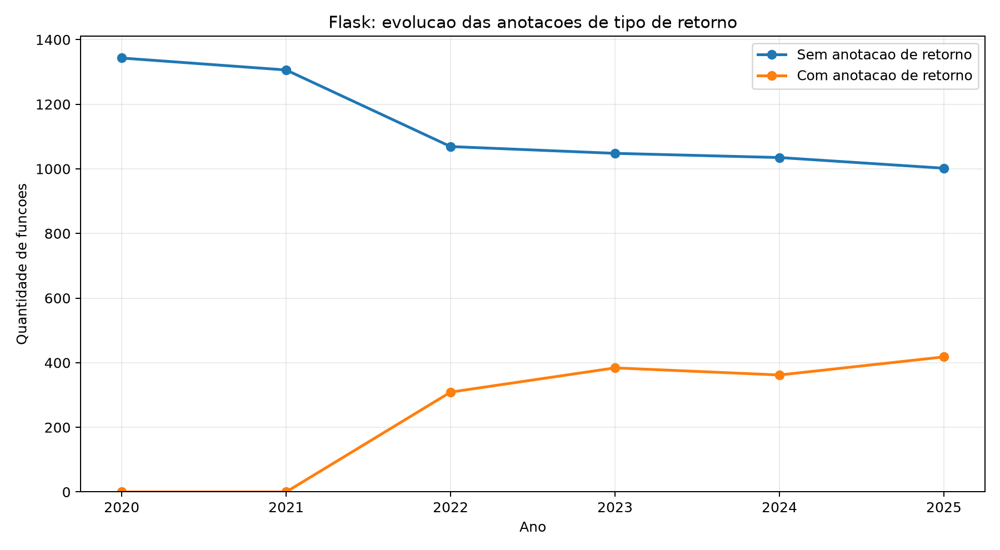

# Explorando evolução de código

Neste exercício, iremos explorar a evolução de código em sistemas reais.

Iremos utilizar a ferramenta [GitEvo](https://github.com/andrehora/gitevo).
Essa ferramenta analisa a evolução de código em repositórios Git nas linguagens Python, JavaScript, TypeScript e Java, e gera relatórios `HTML` como [este](https://andrehora.github.io/gitevo-examples/python/pandas.html).

Mais exemplos de relatórios podem ser podem ser encontrados em https://github.com/andrehora/gitevo-examples.

# Passo 1: Selecionar repositório a ser analisado

Selecione um repositório relevante na linguagem de sua preferência (Python, JavaScript, TypeScript ou Java).
Você pode encontrar projetos interessantes nos links abaixo:

- Python: https://github.com/topics/python?l=python
- JavaScript: https://github.com/topics/javascript?l=javascript
- TypeScript: https://github.com/topics/typescript?l=typescript
- Java: https://github.com/topics/java?l=java

# Passo 2: Instalar e rodar a ferramenta GitEvo

> [!NOTE]
> Antes de instalar a ferramenta, é recomendado criar e ativar um [ambiente virtual Python](https://packaging.python.org/en/latest/guides/installing-using-pip-and-virtual-environments/#create-and-use-virtual-environments).

Instale a ferramenta [GitEvo](https://github.com/andrehora/gitevo) com o comando:

```
$ pip install gitevo
```

Execute a ferramenta no repositório selecionado utilizando o comando abaixo (ajuste conforme a linguagem do repositório).
Substitua `<git_url>` pela URL do repositório que será analisado:

```shell
# Python
$ gitevo -r python <git_url>

# JavaScript
$ gitevo -r javascript <git_url>

# TypeScript
$ gitevo -r typescript <git_url>

# Java
$ gitevo -r java <git_url>
```

Por exemplo, para analisar o projeto Flask escrito em Python:

```
$ gitevo -r python https://github.com/pallets/flask
```

> [!NOTE]
> Essa etapa pode demorar alguns minutos pois o projeto será clonado e analisado localmente.

# Passo 3: Explorar o relatório de evolução de código

Após executar a ferramenta [GitEvo](https://github.com/andrehora/gitevo), é gerado um relatório `HTML` contendo diversos gráficos sobre a evolução do código.

Abra o relatório `HTML` e observe com atenção os gráficos.

# Passo 4: Explicar um gráfico de evolução de código

Selecione um dos gráficos de evolução e explique-o com suas palavras.
Por exemplo, você pode:

- Detalhar a evolução ao longo do tempo
- Detalhar se as curvas estão de acordo com boas práticas
- Explicar grandes alterações nas curvas
- Explorar a documentação do repositório em busca de explicações para grandes alterações
- etc.

Seja criativo!

# Instruções para o exercício

1. Crie um `fork` deste repositório (mais informações sobre forks [aqui](https://docs.github.com/pt/pull-requests/collaborating-with-pull-requests/working-with-forks/fork-a-repo)).
2. Adicione o relatório `HTML` no seu fork.
3. No Moodle, submeta apenas a URL do seu `fork`.

## Respostas

### 1. Repositório selecionado

https://github.com/pallets/flask

O Flask é um framework de desenvolvimento web em Python. Escolhi esse projeto por ter um histórico de manutenção extenso e documentação das mudanças, o que permite relacionar os gráficos com decisões reais de desenvolvimento.

### 2. Gráfico selecionado

**Function return type — evolução das anotações de tipo de retorno das funções.**



A imagem foi renderizada a partir dos mesmos dados do gráfico `Function return type` do [relatório HTML gerado pelo GitEvo](relatorio/report_flask.html). As legendas foram traduzidas: `yes` representa funções com anotação explícita de retorno e `no`, funções sem essa anotação.

### 3. Explicação

O gráfico mostra uma mudança na forma como o projeto descreve o retorno das suas funções. Em Python, uma assinatura como `def nome() -> str:` informa que a função deve retornar uma string. Essa informação ajuda na leitura do código e permite que ferramentas de análise estática verifiquem incompatibilidades de tipos.

Nos pontos de 2020 e 2021, o GitEvo não encontrou funções com anotação de retorno. Na amostra de 2022, esse número passa para 309, enquanto as funções sem anotação caem de 1.306 para 1.069. O total de funções aumenta de 1.306 para 1.378 nesse intervalo. Portanto, a mudança não corresponde apenas à criação de funções novas: os dados sugerem que funções existentes também passaram a receber anotações.

Para entender essa alteração, consultei o histórico do Flask. A versão **2.0.0, lançada em 11 de maio de 2021**, registra a inclusão de *type hinting*. O [pull request #3973](https://github.com/pallets/flask/pull/3973), incorporado em **27 de abril de 2021**, adicionou anotações ao código e configurou verificações com o **mypy**, uma ferramenta de análise estática de tipos. Assim, há evidência no próprio repositório de uma iniciativa de adoção dessa prática.

Um detalhe importante é que **o ano no eixo horizontal representa uma amostra do código, e não todas as alterações daquele ano**. O ponto de 2021 corresponde a um commit de **1º de janeiro**, anterior à incorporação do pull request. Já o ponto de 2022 corresponde a **13 de janeiro de 2022**, quando as mudanças já estavam presentes. Isso explica por que a adoção feita em 2021 aparece na curva somente no ponto de 2022.

| Ano no gráfico | Data do commit analisado | Com anotação de retorno | Sem anotação de retorno |
| --- | --- | ---: | ---: |
| 2020 | [2020-02-06](https://github.com/pallets/flask/commit/ce08807a8b1f1229a1c390b6a86d5ee0f4029da0) | 0 | 1343 |
| 2021 | [2021-01-01](https://github.com/pallets/flask/commit/e4c70eff7747abf12726d90f38d3c28006baf087) | 0 | 1306 |
| 2022 | [2022-01-13](https://github.com/pallets/flask/commit/a025ee3f25044145a38e650aaf097f32bc5b2e83) | 309 | 1069 |
| 2023 | [2023-01-01](https://github.com/pallets/flask/commit/bb1f83c26586f1aa254d67a67e6b692034b4cb4a) | 384 | 1048 |
| 2024 | [2024-01-01](https://github.com/pallets/flask/commit/63ff4185f9d1306c3bd54489f1adb88e7b48e588) | 362 | 1035 |
| 2025 | [2025-01-05](https://github.com/pallets/flask/commit/6b361ce06b08454329286214072139228e8c2f33) | 418 | 1002 |

Depois desse salto, a quantidade de funções anotadas sobe para 384 em 2023, recua para 362 em 2024 e chega a 418 em 2025. A pequena queda não comprova abandono da prática: o gráfico apresenta quantidades absolutas, que também podem mudar com remoções ou reorganizações do código. Seria necessário examinar os commits intermediários para atribuir uma causa a esse recuo.

Na amostra de 2025, aproximadamente **29,4%** das funções identificadas possuem anotação explícita de retorno: 418 de um total de 1.420. Esse percentual se refere aos arquivos Python analisados no repositório, incluindo testes e exemplos, e não apenas ao código principal do framework. Por isso, não seria correto afirmar que o Flask possui somente 29,4% de seu código principal tipado.

Considero a adoção das anotações compatível com boas práticas de manutenção, pois elas tornam os contratos das funções mais claros e apoiam a detecção de erros antes da execução. Entretanto, sua presença não garante que a anotação esteja correta, nem substitui testes. O gráfico evidencia uma mudança concreta no código; a documentação e o pull request ajudam a explicar a decisão que levou a ela.

### Reprodução da análise

A análise foi executada com **GitEvo 0.1.3**, Python 3.11 e amostragem anual de 2020 a 2025, pelo GitHub Actions deste fork:

```bash
pip install gitevo==0.1.3
gitevo -r python -f 2020 -t 2025 https://github.com/pallets/flask
```

O intervalo foi limitado a 2025 para não incluir o ano de 2026 ainda em andamento. Os pontos representam os commits listados na tabela, não médias anuais nem necessariamente o fechamento de cada ano. Os [dados do gráfico](relatorio/grafico-selecionado.json) e as [versões das dependências](relatorio/dependencias.txt) estão disponíveis para conferência.

### Fontes consultadas

- [Relatório HTML desta execução](relatorio/report_flask.html).
- [Histórico oficial do Flask — versão 2.0.0](https://flask.palletsprojects.com/en/stable/changes/#version-2-0-0).
- [Pull request #3973 — Typing](https://github.com/pallets/flask/pull/3973).
- [Definição das métricas Python no GitEvo](https://github.com/andrehora/gitevo/blob/main/gitevo/reports/python.py).
